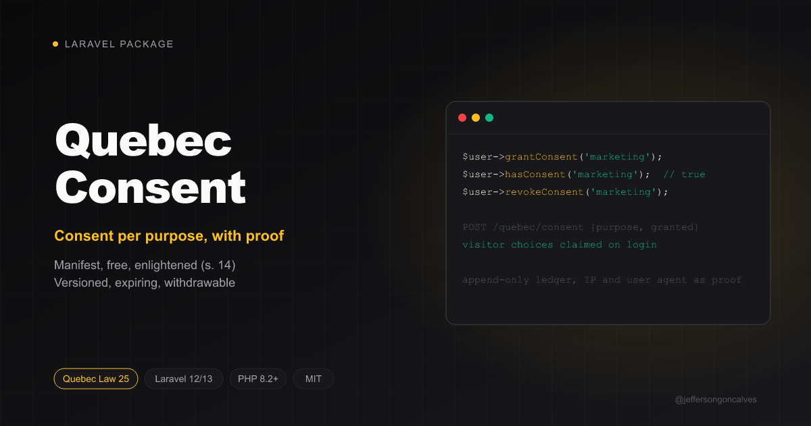

# Laravel Quebec Consent



[](https://packagist.org/packages/jeffersongoncalves/laravel-quebec-consent)
[](https://github.com/jeffersongoncalves/laravel-quebec-consent/actions/workflows/tests.yml)
[](https://packagist.org/packages/jeffersongoncalves/laravel-quebec-consent)

Consent ledger for Quebec's Act respecting the protection of personal information in the private sector, as amended by Law 25. It is part of the [laravel-quebec](https://github.com/jeffersongoncalves/laravel-quebec) suite.

Under Law 25, consent must be manifest, free and enlightened, given for specific purposes and requested for each purpose separately, in clear and simple terms; it is valid only as long as needed to achieve the purposes (s. 14). Sensitive information needs express consent (s. 12), and under 14 consent comes from the person having parental authority (s. 4.1; see laravel-quebec-minors). Keep the proof. This package records every decision as a new row, and never updates or deletes a row:

- grants and revocations per **purpose**, with the **terms version** in force at the time;
- proof of consent: IP address, user agent, source, and custom metadata;
- when you bump a purpose's terms version, consents given under the old version stop counting;
- consents can expire after a period you configure;
- works for users (any Eloquent model) and for anonymous visitors (a random id stored in a cookie);
- an optional endpoint where your cookie banner can record each choice.

> This package gives you tooling. It does not make you compliant on its own. You still need legal review for your purposes and terms.

## Installation

```bash
composer require jeffersongoncalves/laravel-quebec-consent
php artisan vendor:publish --tag="quebec-consent-migrations"
php artisan migrate
php artisan vendor:publish --tag="quebec-consent-config"
```

## Configuration

```php
// config/quebec-consent.php
'purposes' => [
    'marketing' => ['version' => '2026-11', 'expires_after' => '1 year'],
    'analytics' => ['version' => '1'],
],
```

When `purposes` is set, unknown purposes are rejected. When it is empty, any purpose is accepted and no version is enforced.

## Usage

```php
use JeffersonGoncalves\QuebecConsent\Concerns\HasConsents;

class User extends Authenticatable
{
    use HasConsents;
}

$user->grantConsent('marketing', source: 'signup-form', metadata: ['checkbox' => 'newsletter']);
$user->hasConsent('marketing');   // true
$user->revokeConsent('marketing');
$user->consents;                  // full history
```

For visitors who have no account, or from anywhere else:

```php
use JeffersonGoncalves\QuebecConsent\Facades\QuebecConsent;

QuebecConsent::grant($anonymousId, 'analytics');
QuebecConsent::has($anonymousId, 'analytics');
QuebecConsent::history($user, 'marketing');
```

Every decision dispatches `JeffersonGoncalves\QuebecConsent\Events\ConsentRecorded`.

### Endpoint for banners

Enable it with `route.enabled => true`, then send:

```js
fetch('/quebec/consent', {
    method: 'POST',
    headers: { 'Content-Type': 'application/json', 'X-CSRF-TOKEN': token },
    body: JSON.stringify({ purpose: 'analytics', granted: true }),
});
```

A logged-in user's choice is recorded on the user. A guest's choice is recorded under a random id, which is kept in an encrypted cookie (`quebec_consent_id`).

When a guest logs in, their decisions move to the account. For each purpose, the guest's latest decision is copied onto the user as a new record, with source `claimed` and the guest id plus the original record id in its metadata. The original IP address, user agent and expiry are kept as the proof. A decision the user made after the guest's one wins. The guest rows stay untouched, because the ledger is append-only. This runs on Laravel's `Login` event when the endpoint is enabled. Turn it off with `route.claim_on_login => false`, or call it yourself:

```php
QuebecConsent::claim($anonymousId, $user);   // returns the records it created
```

### Append-only

Calling `update()` or `delete()` on a `ConsentRecord` throws an exception. The one exception is the personal data columns (`ip_address`, `user_agent`): the records are declared with [laravel-quebec](https://github.com/jeffersongoncalves/laravel-quebec)'s `#[PersonalData]`, so you can still clear those columns with `$record->anonymizePersonalData()`.

## Upgrading to 2.0

2.0 runs on [laravel-privacy](https://github.com/jeffersongoncalves/laravel-privacy), the engine shared by the
LGPD, GDPR, CCPA, US privacy and Quebec suites. The classes, config keys, tables, commands and events of this package
keep their names: your code, config and data need no change. Suites installed side by side never see each other's
events. If you extend a class of this package, it now inherits from its `JeffersonGoncalves\Privacy` base.

## Testing

```bash
composer test
```

## Changelog

See [CHANGELOG](CHANGELOG.md).

## License

The MIT License (MIT). See [License File](LICENSE.md).
